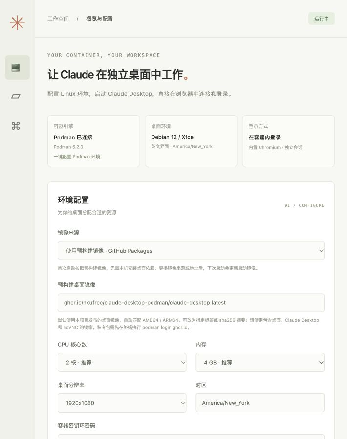
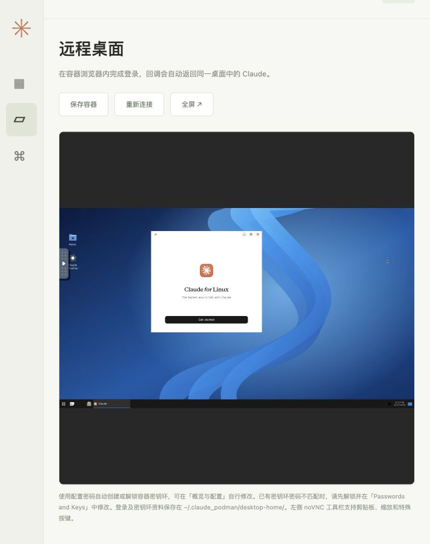
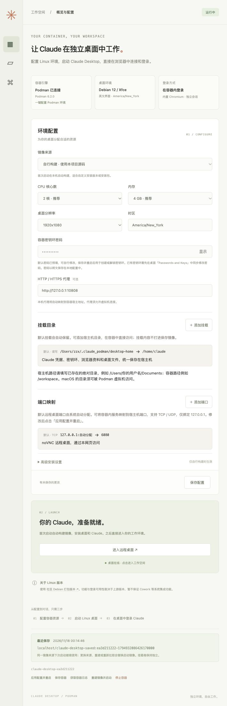

# Claude Desktop Podman · 网页工作空间

从项目目录启动一个本地网页，在网页中配置并启动带桌面的 Linux 容器，使用内嵌远程桌面控制 Claude Desktop。**直接在容器里的 Chromium 浏览器完成登录，无需在宿主机先登录。** 登录资料统一保存在宿主机 `~/.claude_podman/desktop-home/`，无需导入宿主机原有 Claude 凭据。

容器默认使用 **美国纽约时区 `America/New_York`、英文 `en_US.UTF-8`**，提供 Debian 12、Xfce、Chromium、Claude Desktop 与 noVNC，支持 ARM64 和 AMD64。

桌面预装现成的 [Fluent GTK Theme](https://github.com/vinceliuice/Fluent-gtk-theme)，采用 Windows Fluent 风格的浅色控件和 Xfwm4 窗口装饰，搭配 Papirus 图标、Whisker 开始菜单及底部任务栏。主题固定为上游提交 `7a49a464b0188c340101c52965c18190b1c694cf` 并校验 SHA256；直接安装上游预编译样式资源，保留其 GPL 许可证。首次应用会备份已有 Xfce 配置，之后保留用户自定义外观。

Linux 安装包来自 [aaddrick/claude-desktop-debian](https://github.com/aaddrick/claude-desktop-debian) 的社区打包版本。该项目不属于 Anthropic 官方 Linux 发行版；桌面登录和功能兼容性取决于社区版本及上游服务。Cowork 等依赖系统集成的功能不保证可用。

## 页面展示

以下为项目实际运行截图。网页中选择镜像来源、配置资源后，可直接进入 Linux 桌面，在容器内部登录 Claude。

| 预构建镜像配置 | 浏览器远程桌面 |
| --- | --- |
|  |  |

<details>
<summary>查看完整环境配置页：挂载目录、端口映射与保存容器</summary>



</details>

## 启动

需要 Python 3.9+ 和 Podman。网页服务仅使用 Python 标准库，不需要 npm、pip 或前端构建。

```sh
# macOS，先安装容器引擎
brew install podman

# 在本项目目录执行
./bin/claude-desktop
# 或
make serve
```

命令会打开 [http://localhost:8765](http://localhost:8765)。如浏览器没有自动打开，手动访问即可。

1. macOS 在页面点击「一键配置 Podman 环境」：使用 Homebrew 补装缺少的 Podman、初始化 / 启动虚拟机，并应用配置中的代理。需要事先安装 [Homebrew](https://brew.sh)；已有环境会被复用。Linux 使用发行版包管理器安装 Podman，无需虚拟机。
2. 选择「自行构建」或「使用预构建镜像」，检查 CPU、内存、桌面分辨率、时区和代理，点击「保存并启动桌面」。首次按所选方式构建或拉取镜像，日志实时更新。
3. 准备完成后自动进入「远程桌面」。Claude 会随桌面启动，也可使用桌面快捷方式。
4. 在 Claude 中选择登录，在**容器内** Chromium 中完成认证。若浏览器询问打开 Claude，请允许，`claude://` 回调由同一个容器处理。

```sh
./bin/claude-desktop --port 9000       # 改变网页端口
./bin/claude-desktop --no-browser      # 不自动打开浏览器
PYTHON=/path/to/python3 ./bin/claude-desktop
make image-desktop                   # 仅构建镜像
make check                           # 单元测试、HTTP/WebSocket 集成测试和语法检查
```

停止网页服务（Ctrl+C）不会停止容器。通过页面「停止容器」关闭桌面；重启网页服务会重新检测已有容器。再次启动或重建镜像会替换此项目的容器，宿主机 home 挂载目录会保留。请先保存桌面中的工作。

## 选择镜像来源

网页「镜像来源」提供两种启动方式，默认保留自行构建：

| 方式 | 行为 |
| --- | --- |
| 自行构建 | 使用项目 `desktop/Containerfile`，在本机安装桌面、主题和 Claude Desktop；可设置社区版本、自定义 `.deb` 和 Debian 软件源 |
| 使用预构建镜像 | 直接拉取 GitHub Packages 中发布的完整桌面镜像，跳过本机构建；高级安装设置隐藏，以镜像内版本为准 |

默认预构建地址为 `ghcr.io/nkufree/claude-desktop-podman/claude-desktop:latest`，也可指定 `:sha-提交完整SHA` 标签或 `@sha256:摘要`。镜像支持 AMD64 / ARM64，Podman 根据当前架构自动选择。这里使用的是完整桌面镜像，原来的 `claude-code` package 仅提供旧版命令行工具，不能用于网页桌面。

主分支更新、定时任务和手动触发会通过 GitHub Actions 在原生 AMD64、ARM64 runner 构建桌面，两个架构都成功后才发布多架构 `latest` 和提交标签。新 package 首次发布默认为私有时，仓库所有者需在 package 设置中将可见性改为 Public，才能免登录拉取；私有包先在宿主机终端执行 `podman login ghcr.io`，网页不保存仓库令牌。

同一来源下普通启动复用本地镜像和最近保存的容器快照，不会每次下载 `latest`。「重新拉取镜像并启动」会更新预构建镜像；「重建镜像并启动」会按本机设置重新构建。更换镜像来源或地址后，下一次启动会更新启动镜像。新镜像准备失败时保留当前容器，不会自动改用另一种方式。更换或刷新启动镜像会取消最近快照的默认启动选择，旧快照仍保留在 Podman 中，挂载目录始终保留。

## 保存容器

网页概览底部点击「保存容器」，将当前容器文件系统提交为一个有独立名称的本地 Podman 镜像，并设为本项目下次启动使用的镜像。可以保存容器内安装的软件、系统文件等改动，运行中或已停止的容器都可以保存。运行中保存时，Podman 会短暂暂停容器以保证镜像一致性。

**挂载卷不额外保存，也不打进镜像。** 登录信息、浏览器资料和桌面文件保存在宿主机 `~/.claude_podman/desktop-home/`，挂载到容器 `/home/claude`。「最近保存」显示镜像名称和时间，运行日志显示操作结果。镜像保存在当前 Podman 存储中，不导出为额外的归档文件。

「启动桌面」在相同来源下会使用最近保存的启动镜像；更换来源、重建或重新拉取会替换启动镜像，原有具名快照仍保留在 Podman 中。删除宿主机登录目录后，登录资料不会从镜像中恢复。

## 配置与持久化

| 配置 | 默认值 / 行为 |
| --- | --- |
| CPU / 内存 | 2 核 / 4096 MiB；macOS 虚拟机需有足够资源 |
| 分辨率 | 1920 × 1080，远程连接支持调整大小 |
| 时区 | `America/New_York`，可改为 `America/Los_Angeles` 等 IANA 时区 |
| 语言 | 桌面、Chromium 和 Claude 使用英文 `en_US.UTF-8` / `en-US` |
| Debian 软件源 | `http://deb.debian.org`，可选 `http://mirrors.ustc.edu.cn`，APT 验证 Debian 签名 |
| 安装版本 | `latest`，首次构建时解析 GitHub 发布版本；可填写固定版本标签 |
| 自定义安装包 | 可选 HTTPS `.deb` 地址，应匹配主机 ARM64 / AMD64 架构 |
| SHA256 | 可选校验值；GitHub 提供文件摘要时自动校验 |
| 容器密钥环密码 | `fuckclaude`，可在网页自行修改；右侧按钮悬停显示明文，点击切换持续显示 / 隐藏 |
| HTTP / HTTPS 代理 | 首次启动尝试读取环境变量和 macOS 系统 HTTP 代理，可在页面修改 |
| 镜像来源 | 默认自行构建；可选择 GitHub Packages 中的预构建桌面镜像 |
| 预构建地址 | `ghcr.io/nkufree/claude-desktop-podman/claude-desktop:latest`，支持标签和 SHA256 摘要 |

配置保存到 `.desktop-state/config.json`（不纳入 Git）。密钥环密码按要求以明文保存，本地配置文件权限为 `0600`；启动时复制到 home 挂载目录下的 `.config/claude-podman/keyring-password`（同为 `0600`），通过标准输入解锁，不写入容器环境变量或保存镜像。容器和镜像名称附带项目路径生成的标识。默认将宿主机 `~/.claude_podman/desktop-home/` 挂载到容器 `/home/claude`，统一保存 Claude 凭据、浏览器登录资料、密钥环和桌面文件。目录会自动创建；旧版容器的 home 卷会在首次迁移到空目录时复制过来，原卷保留。不同项目副本共享该登录目录，请勿同时启动多个桌面写入同一资料目录。

网页「挂载目录」列出默认宿主路径和容器路径。点击「添加挂载」可填写已存在的宿主机绝对目录、容器内绝对目录，并选择只读模式。自定义目录不能覆盖默认 home 或系统运行目录。保存配置后重新启动桌面生效，挂载内容始终不打进保存镜像。macOS 路径须已共享给 Podman 虚拟机（新建虚拟机通常共享用户 home 目录）。

网页「端口映射」列出自动分配的 noVNC 端口，并支持添加、移除 TCP / UDP 映射。例如宿主机 `18080` → 容器 `8080`，可通过 `http://127.0.0.1:18080` 访问容器内监听 `0.0.0.0:8080` 的 HTTP 服务。自定义映射仅监听宿主机 `127.0.0.1`，同一协议的宿主机端口不能重复。挂载、资源、代理和端口修改后，点击「应用配置并重启」生效；请先保存桌面中的工作。

**自行构建时修改安装版本或安装包 URL 后，点击「重建镜像并启动」；使用预构建镜像时更新镜像需点击「重新拉取镜像并启动」。仅修改 CPU、内存、时区、代理或分辨率时，重新启动桌面即可。** `latest` 不会在每次启动时自动升级本地镜像。

默认仅挂载专用的 `~/.claude_podman/desktop-home/`，其他工作目录由用户在网页中添加；不导入 `~/.claude`、宿主机浏览器资料或宿主机钥匙串。Linux 容器以非 root 用户运行，移除额外系统能力，禁用新增权限。Electron/Chromium 使用 `--no-sandbox` 以适配容器环境，隔离边界由 Podman 提供。

## 代理

例如系统代理为 `http://127.0.0.1:10808`，填写在网页的代理字段即可。构建依赖下载、Claude 和容器浏览器都会使用该代理。宿主回环地址会转换成容器内可达的 `host.containers.internal`，不会误指向容器自身。

代理软件需要允许 Podman 虚拟机访问。如果桌面能启动但打不开网站，请检查代理的 LAN / 虚拟机访问设置与防火墙。`127.0.0.1` 上仅监听本机的代理可能需要开启「允许局域网」。

Podman 下载虚拟机镜像或拉取基础镜像发生在宿主机 / 虚拟机层，容器的代理设置无法修复这一步的网络。可在启动网页前设置：

```sh
export HTTP_PROXY=http://127.0.0.1:10808
export HTTPS_PROXY=http://127.0.0.1:10808
export NO_PROXY=localhost,127.0.0.1,::1
./bin/claude-desktop
```

macOS 构建前会将网页中的代理同步到运行中虚拟机的 Podman 后台服务，并重启该服务，使基础镜像拉取也使用代理。Linux 的远程 Podman 服务如仍无法访问仓库，需要在服务端配置可访问的代理。请勿在镜像参数中填写带密码的代理；目前配置界面仅接受无认证 HTTP 代理。

预构建镜像拉取同样使用网页代理配置；macOS 会先同步到 Podman 虚拟机的镜像服务。

## 远程桌面和访问范围

```text
本机浏览器 → Python 控制台 :8765 → Podman CLI
                    │
                    └─ /desktop/ HTTP + WebSocket 代理
                              → 127.0.0.1:随机端口 → 容器 noVNC :6080
                                                       → VNC 127.0.0.1:5901
                                                       → Xfce + Claude + Chromium
```

网页服务绑定 `127.0.0.1`；容器 noVNC 端口仅发布到宿主回环地址，VNC 本身不发布。控制台包含同源检查、会话验证和修改操作的 CSRF 校验。接口同时支持页面令牌与会话 Cookie，远程桌面通过带会话令牌的路径连接，兼容浏览器禁用 Cookie 的情况。本地存储被禁用时，noVNC 界面偏好暂存于当前桌面页面内存，刷新后重置。令牌不转发给容器，请勿分享带令牌的桌面地址。noVNC 提供剪贴板、特殊按键与缩放工具栏。

如需从其他机器使用，通过 SSH 隧道转发：

```sh
ssh -L 8765:127.0.0.1:8765 user@host
# 然后本机浏览器打开 http://localhost:8765
```

该服务用于个人本地工作空间，没有公网多用户认证功能。

## 故障排查

- **Edge 停在检查中或配置接口返回 401**：确认命令行网页服务仍在运行，并通过终端显示的 `http://localhost:端口/` 访问。服务重启后刷新整个控制台页面以获取新会话；旧页面和旧桌面地址会失效。新版不依赖 Cookie 或本地存储读取配置，请更新代码、重启网页服务后强制刷新。若扩展的 `content.js` 报本地存储访问被拒绝，可暂时禁用该站点的扩展后重试。
- **Podman 未安装**：macOS 使用 `brew install podman`。程序也会查找 `/opt/homebrew/bin`、`/usr/local/bin` 和 `~/.local/homebrew/bin` 下的 Podman。
- **引擎未连接**：macOS 在页面启动虚拟机，或使用 `podman machine list` / `podman machine start`。已有虚拟机将被复用，不会修改其资源。
- **镜像构建失败**：「运行日志」查看具体错误；检查代理、GitHub 访问限制及发行版依赖。可以指定固定发布版本或自定义包地址后重建。
- **预构建镜像拉取失败**：确认桌面发布 workflow 已完成；尚未发布的标签会返回 manifest unknown。私有 package 先 `podman login ghcr.io`，或由所有者设为 Public。检查代理和架构，`claude-code` package 不包含远程桌面。
- **进入远程桌面后日志增多**：websockify 和 VNC 会记录连接、协议协商、画面编码及断开统计，通常属于正常输出。Debian noVNC 的 `package.json` 404 只影响版本信息显示；持续断线、认证失败或浏览器红色异常需要另行排查。
- **桌面可见但 Claude 未启动**：页面点击「获取容器日志」；在容器终端执行 `launch-claude` 查看错误。更新社区安装包可能需要调整依赖或启动命令。
- **登录未回到 Claude**：允许 Chromium 打开 `claude://`，保持容器内 Claude 运行；不要将认证链接复制到宿主浏览器完成。
- **密钥环提示密码**：默认密码为 `fuckclaude`，在网页「容器密钥环密码」中可自行修改，保存配置并重启后生效。启动时自动创建或解锁密钥环；已有密钥环需要先在桌面菜单的「Passwords and Keys」中右键 Login 密钥环 → Change Password，同步修改为新密码。修改网页配置不会重置已有密钥环，也不会清除登录资料。Claude 会等待密钥环就绪后启动，以便加密保存登录资料；取消后可双击桌面快捷方式重试。密钥环保存在宿主机专用 home 挂载目录，无需使用宿主机钥匙串。
- **恢复默认配置**：停止网页服务，备份并移走 `.desktop-state/config.json`。删除配置文件不会删除宿主机登录目录。
- **查看挂载和镜像名称**：页面概览显示默认挂载，`/api/status` 中包含对应 image / home_path。停止容器不会自动删除登录资料。

## 项目结构

```text
bin/claude-desktop     命令行网页启动入口
webapp/               配置、Podman 生命周期、HTTP / WebSocket 代理
webapp/static/        中文配置控制台与远程桌面页面
desktop/              Debian 桌面 Containerfile、安装器、桌面启动脚本
tests/                配置、容器命令、安全边界和双向代理测试
```

另保留 Claude Code 命令行启动器 `bin/claude`，使用方法见 [Claude Code 命令行说明](docs/legacy-cli.md)。该启动器与网页桌面使用独立镜像与登录存储。

## 许可证

本项目采用 [AGPL-3.0-or-later 许可证](https://www.gnu.org/licenses/agpl-3.0.html)。
